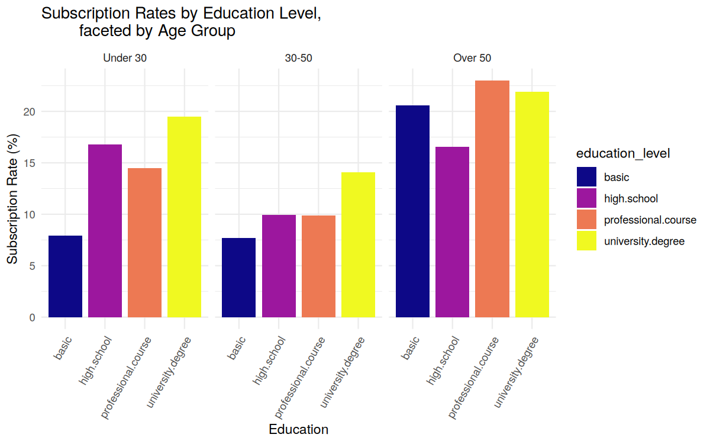

# Bank Telemarketing Campaign: EDA & Insights (R)

An exploratory analysis of a Portuguese bank's phone campaign for term deposits. I wanted to answer two practical questions: **who subscribes, and what should the marketing team do differently?** The analysis is written in R Markdown and knits to an interactive HTML report with plotly charts.

## Key insights

- **Only 11.9% of contacted clients subscribed**, so most calls simply don't convert. Calling everyone is expensive, and the team needs to know where to focus.
- **Warm leads convert about 6× better.** Clients contacted in a previous campaign subscribe at around 65–70%, against about 11% for first-time contacts. If I were on the marketing team, every warm lead would get a follow-up call first. There are only 261 of them, though (4.3% of the 6,039 clients left after cleaning), so that's a first step, not a place to pour the whole budget.
- **Age and education matter.** Clients over 50 and university-educated clients under 30 respond best. The 30–50 group is the largest but also responds worst, and I'd research why before writing them off.
- **Students (33%) and retirees (32%)** have the highest subscription rates, blue-collar workers the lowest (9%). The chi-squared test gives p < 2e-16, so this isn't noise.
- **Successful calls last about twice as long** (518 s vs 220 s). But that's a correlation, not a lever: call length is only known *after* the call, so you can't use it to decide who to call.



## What's in the report

1. **Data quality.** "unknown" categories, missing values, duplicates, outliers (age, call duration, campaign contacts), and the *pdays* = 999 sentinel, which means "never contacted" rather than an actual number of days.
2. **Cleaning & feature engineering.** Cleaning removes 2,198 of the 8,237 rows (27%), almost all of them because of an "unknown" value, mostly in *default*. That leaves 6,039 clients with a 13.3% subscription rate. Next time I'd keep "unknown" as its own category instead, because clients who won't state their default status may well behave differently. Education levels are grouped, and there are three new features: age group, contact recency and total contact attempts.
3. **Relationship analysis.** Correlation tests, a chi-squared test, and subscription rates per segment.
4. **Interactive visualisations.** plotly bar charts and a faceted ggplot.
5. **Business recommendations.** Two target personas, research into the under-performing 30–50 segment, and a shift from call volume to call quality.

## Run it

```r
install.packages(c("dplyr", "tidyr", "ggplot2", "plotly", "knitr", "rmarkdown"))
rmarkdown::render("bank_marketing_eda.Rmd")
```

Open *bank_marketing_eda.html* in a browser to see the knitted report with its interactive charts.

## Data

The data is an 8,237-row sample of the [UCI Bank Marketing dataset](https://archive.ics.uci.edu/dataset/222/bank+marketing) (Moro et al., 2014), stored in *data/bank_marketing.csv*.

## Tech stack

R · dplyr · tidyr · ggplot2 · plotly · R Markdown
