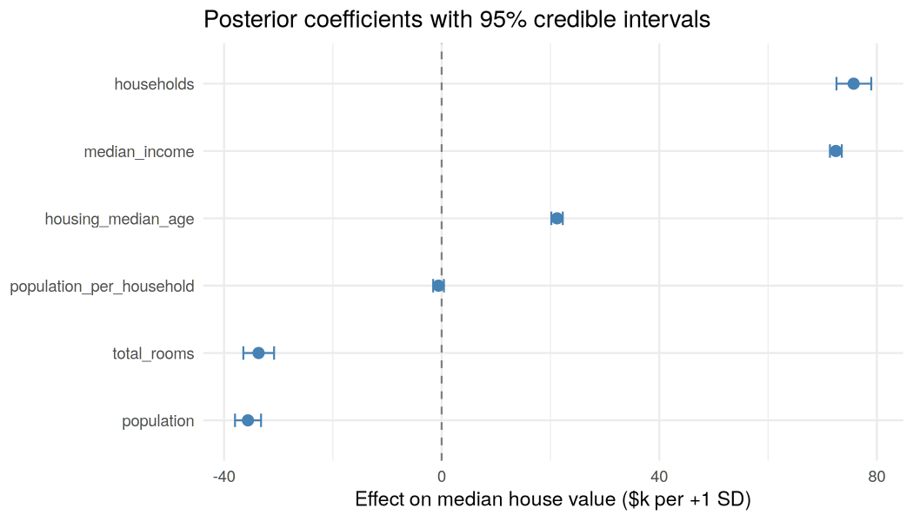
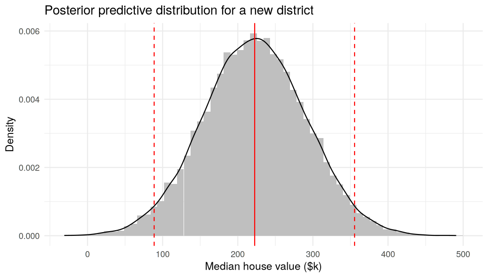
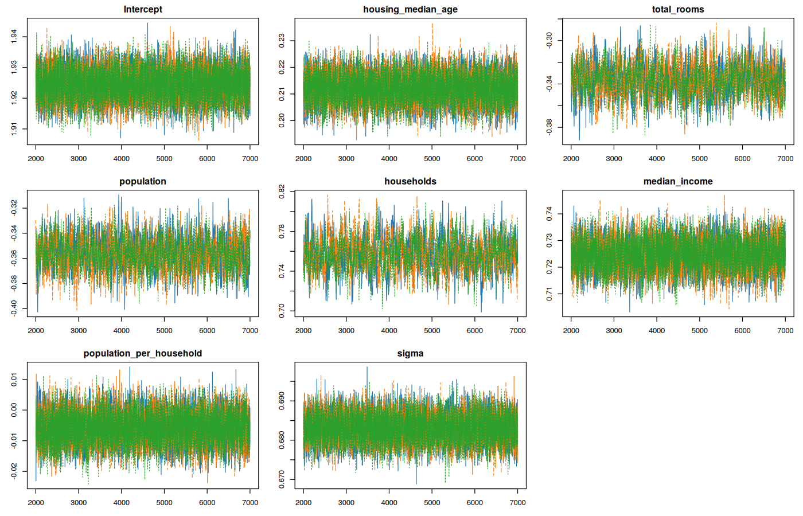

# Bayesian Linear Regression for California House Prices (R + JAGS)

A Bayesian regression of California district house values, fitted with MCMC (Gibbs sampling via JAGS). The focus here is **uncertainty**. A normal regression hands you one number and stays quiet about how sure it is; this one gives every coefficient and every prediction a credible interval. A weather forecast of "28 to 32 °C" is more useful than "30 °C", and I'd argue house prices work the same way.

## Results

*19,475 districts. 3 chains × 5,000 draws after 2,000 burn-in. All R-hat ≤ 1.004.*

| Predictor | Effect on value per +1 SD | 95% credible interval |
|---|---|---|
| Median income | **+$72.5k** | [+71.4k, +73.6k] |
| Households | +$75.7k | [+72.6k, +79.0k] |
| Housing median age | +$21.2k | [+20.2k, +22.3k] |
| Total rooms | −$33.6k | [−36.5k, −30.8k] |
| Population | −$35.6k | [−38.0k, −33.2k] |
| Population per household | −$0.6k | [−1.6k, +0.4k] (not credibly ≠ 0) |



- **Income is the dominant driver** of house value, and it's also the most precisely estimated one.
- *households*, *total_rooms* and *population* are strongly collinear block-level counts, so their opposite signs have to be read **together**, not one by one. At a fixed population, more households (so smaller households) goes with higher values. These are not independent causal effects, and I'd be careful with anyone who reads them that way.
- With weak priors, the posterior means match OLS to within $0.02k. That's a useful sanity check that the priors aren't overpowering the data.
- **Prediction for a new district** (age 30, 2,000 rooms, 800 people, 300 households, income 4.5): the expected value is **$223k** (95% CrI for the mean: $222k–$224k), but the **95% predictive interval is $89k–$355k**. The model is confident about the average, but individual districts vary a lot (σ ≈ $68k, R² ≈ 0.51). A point estimate alone would hide all of that.

| Posterior predictive | MCMC trace plots |
|---|---|
|  |  |

## Method

1. **Cleaning.** Drop missing rows, remove districts at the $500,001 price cap (the cap squashes the whole upper tail into one fake value), and engineer ratio features (rooms per household, bedrooms per room, population per household).
2. **Scaling.** Standardise the predictors and express price in $100k, so the "weakly informative" priors really are weakly informative.
3. **Model.** y ~ Normal(β₀ + Xβ, σ), with β ~ Normal(0, sd ≈ 3.2), β₀ ~ Normal(0, sd = 10) and τ ~ Gamma(0.01, 0.01).
4. **Inference.** JAGS Gibbs sampling with 3 chains.
5. **Diagnostics.** Gelman-Rubin R-hat, effective sample size, trace plots and DIC.
6. **Prediction.** A posterior predictive distribution for a hypothetical district.

## Lessons learned: priors must match the scale of the data

The first version of this project (a group course project) put Normal(0, variance 100) priors on the coefficients of the *raw* variables. That sounds vague, but house values run into the hundreds of thousands of dollars, so at that scale the priors were actually very tight. It's like measuring a highway with a ruler marked in millimetres. They shrank every effect towards zero: income came out at about **$30** per unit instead of about **$46,000**, and the predictive interval stretched into negative prices.

After the course I went back and fixed it myself by standardising the predictors and rescaling the target. Now the posterior agrees with OLS and the chains mix well. The lesson I took from it: a prior is only uninformative **relative to the scale of the data**, and "I used a vague prior" isn't a free pass.

## Next steps

- A log-price likelihood, which keeps predictions positive and fits the right-skewed prices better.
- Location (latitude, longitude, *ocean_proximity*) or a spatial random effect. Location is the biggest missing source of variance, so I'd expect this to help the most.
- Replace the collinear raw counts with per-household ratios.

## Run it

Requires [JAGS](https://mcmc-jags.sourceforge.io/) installed on the system.

```r
install.packages(c("rjags", "coda", "dplyr", "ggplot2"))
```
```bash
Rscript bayesian_regression.R   # takes ~5 minutes; writes figures to images/ (see results.txt for the full output)
```

## Data & credits

The data is the California Housing dataset (1990 U.S. Census; Pace & Barry, 1997), 20,640 block groups, stored in *data/california_housing.csv*.
The original course project was done with Jereldavin Igcander, Wilson Iskandar and Floryant Permana. This repository contains my revised analysis.

## Tech stack

R · JAGS / rjags · coda · dplyr · ggplot2
