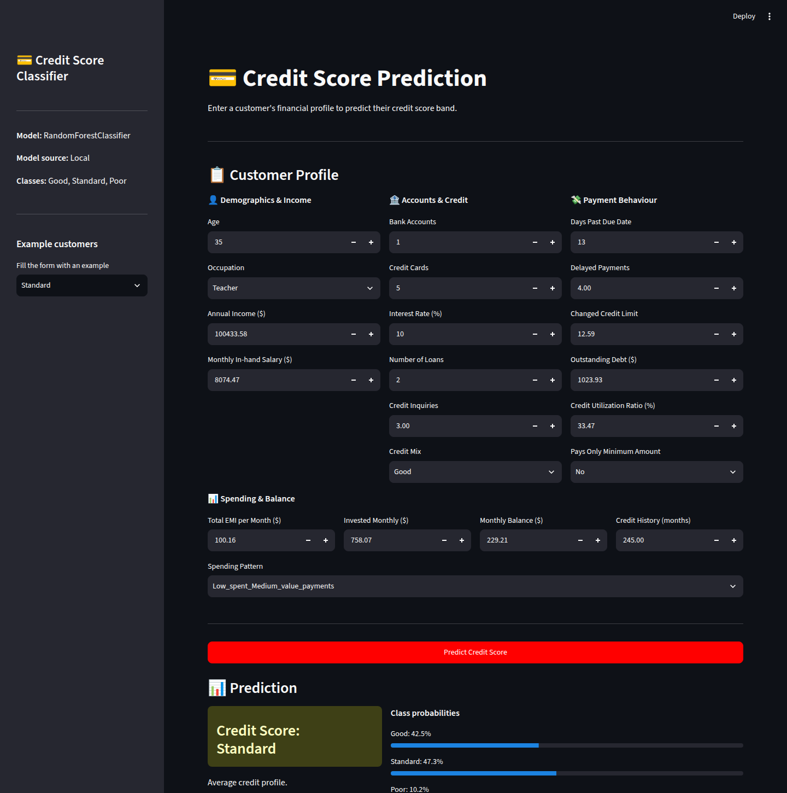
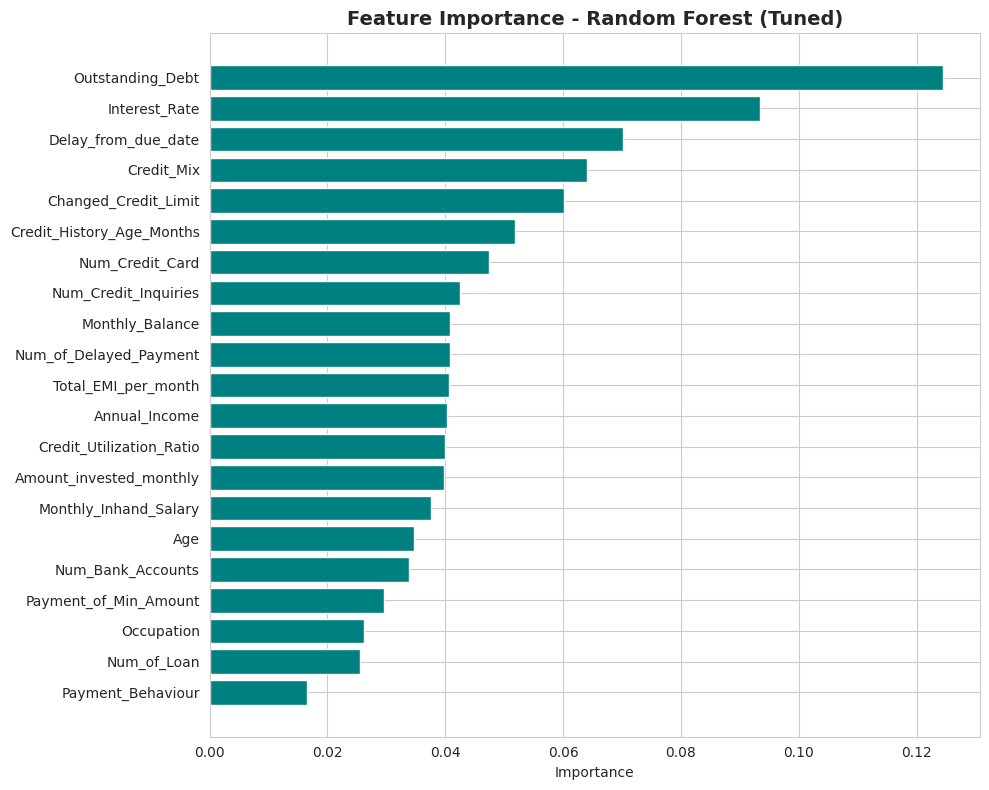
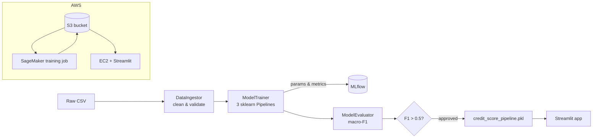
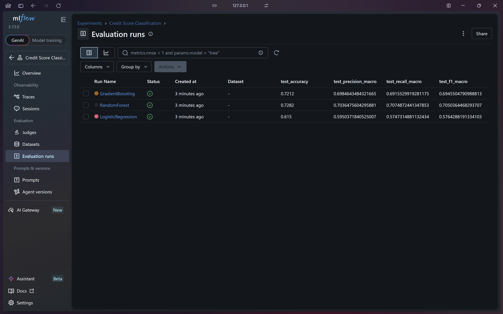
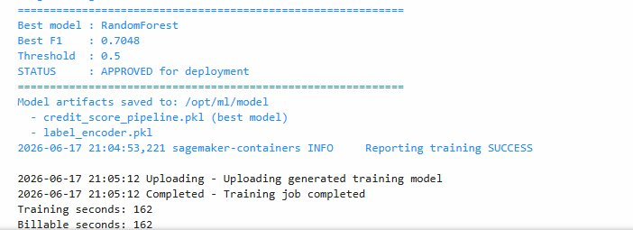

# Credit Score Classification: End-to-End MLOps Pipeline

This project predicts whether a bank customer's credit score is **Good**, **Standard** or **Poor**. I didn't want it to stop at a notebook, so it goes all the way from data cleaning to a live web app: a reproducible training pipeline with MLflow tracking, managed training on SageMaker, and a Streamlit app deployed on EC2. A model that only runs on my laptop isn't really deployed, right?



## Highlights

- **Messy data, cleaned properly.** The raw data has numbers stored as text ("39_"), junk placeholders (_______, !@9#%8), ages like 8,466, and durations written as "22 Years and 1 Months". Most of my effort went here, because a model trained on that would just learn the noise.
- **Leak-free preprocessing.** Imputation, scaling and one-hot encoding all live inside a single scikit-learn *Pipeline*. Think of it as a recipe card that travels with the dish: training and inference follow the exact same steps, so they can't drift apart.
- **Experiment tracking.** Every model run logs its parameters and test metrics to MLflow, so I can compare runs instead of trusting my memory.
- **Approval gate.** The best model is promoted only if its macro-F1 clears a threshold. It's a small safety net against shipping a model that got worse.
- **Cloud deployment.** S3 for data and models, SageMaker for managed training, EC2 for the app.

## Results

The test set is a stratified 20% hold-out (5,000 rows). I use **macro-F1** as the main metric because the classes are imbalanced (Standard 53%, Poor 29%, Good 17%). Plain accuracy would reward a lazy model that predicts "Standard" for everyone; macro-F1 makes the small Good class count just as much.

| Model | Accuracy | Macro-F1 |
|---|---|---|
| Logistic Regression | 0.615 | 0.576 |
| Gradient Boosting | 0.722 | 0.695 |
| **Random Forest (production pipeline)** | **0.728** | **0.705** |
| Random Forest, tuned (notebook experiment) | 0.743 | 0.718 |

The strongest predictors are outstanding debt, interest rate, days past due and credit mix. Nothing surprising there, which is actually reassuring: the model learned what a credit analyst would look at.



## Architecture



The pipeline is split into three classes, *DataIngestor*, *ModelTrainer* and *ModelEvaluator*, each with one job. I split it this way so the cloud version can reuse the exact same cleaning and training code instead of copying it.

## Project structure

```
credit-score-mlops/
├── app.py                  # Streamlit app (local, or on EC2 with S3_BUCKET set)
├── inference.py            # CreditScorePredictor + smoke test
├── data/credit_score_data.csv
├── notebooks/
│   ├── 01_eda.ipynb        # data quality, distributions, outliers, correlations
│   └── 02_modelling.ipynb  # 4 baselines + GridSearch tuning + analysis
├── pipeline/
│   ├── data_ingestion.py   # cleaning
│   ├── train_pipeline.py   # training + MLflow logging
│   ├── evaluate_pipeline.py
│   └── run_pipeline.py     # orchestrator (entry point)
├── aws/                    # S3 helper, cloud pipeline, EC2 setup, IAM policy
└── sagemaker/              # SageMaker training script + job launcher
```

## Run it locally

```bash
pip install -r requirements.txt

# 1. Train (writes models/ and pipeline/mlflow.db)
python pipeline/run_pipeline.py

# 2. Smoke-test inference on three example customers
python inference.py

# 3. Launch the app
streamlit run app.py

# Optional: browse experiment runs
mlflow ui --backend-store-uri sqlite:///pipeline/mlflow.db
```

Training takes about a minute on a laptop.

## Run it on AWS

1. Create an S3 bucket and upload the data to `s3://<bucket>/data/credit_score_data.csv`.
2. **Train.** Pick one:
   - on EC2: `python aws/cloud_pipeline.py --bucket <bucket>`
   - on SageMaker: `cd sagemaker && python launch_training.py --bucket <bucket>`

   Both write the model to `s3://<bucket>/models/`.
3. **Serve on EC2.** Run `./aws/setup_ec2.sh`, then:
   ```bash
   export S3_BUCKET=<bucket>
   streamlit run app.py --server.port 8501 --server.address 0.0.0.0
   ```
   Open inbound port 8501 in the security group. The instance role needs the permissions in *aws/iam_policy_s3.json* (replace `<BUCKET_NAME>` with your bucket).

| MLflow runs | SageMaker training job |
|---|---|
|  |  |

## Data

The data is a 25,000-row sample of the public Kaggle *Credit Score Classification* dataset. It's synthetic customer data, but it comes with the same kind of data quality problems you'd find in a real bank's records, which is exactly why I picked it.

## Tech stack

Python · pandas · scikit-learn · MLflow · Streamlit · AWS (S3, EC2, SageMaker) · boto3
