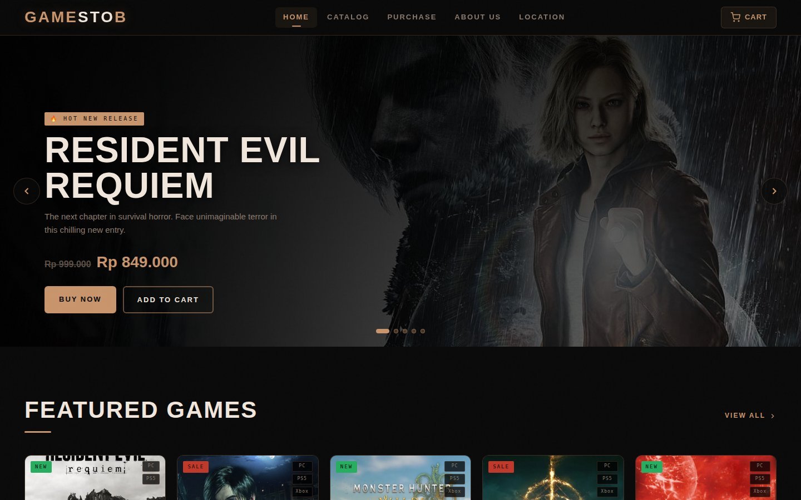
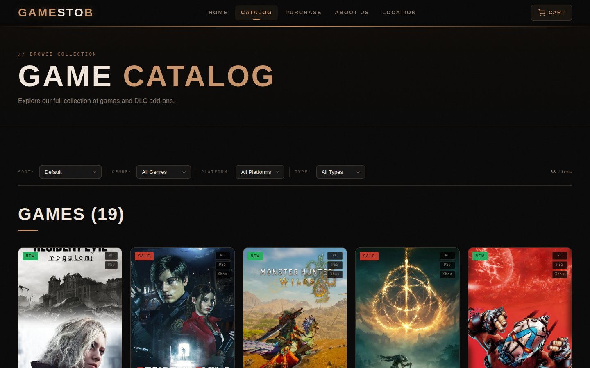
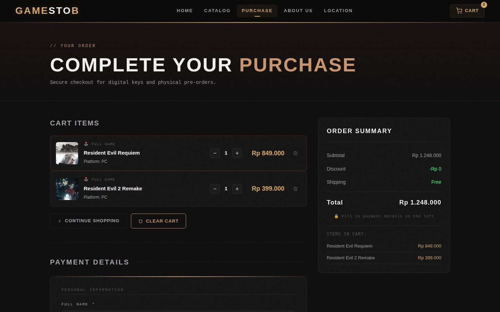

# GameStoB: Game Store Web UI (HCI Project)

A responsive storefront for a fictional video game shop. I designed it in Figma first and then built it from scratch with **plain HTML, CSS and JavaScript**, no frameworks. It was made for a Human-Computer Interaction course, so the point wasn't flashy features. It was usability: clear visual hierarchy, consistent components, system feedback and forgiving form design.

**Live demo:** [dextrafaren66-cmyk.github.io/data-science-portfolio/gamestob](https://dextrafaren66-cmyk.github.io/data-science-portfolio/gamestob/)



## Features

| Page | What it does |
|---|---|
| **Home** | Auto-rotating hero carousel (every 5 s, plus arrows and dots), featured games, promo banner, new releases, DLC row |
| **Catalog** | 38 products as cards; filter by genre, platform (PC / PS5 / Xbox) and type (game / DLC); sort by price; live item count |
| **Cart** | Add to cart from any card with a toast confirmation; the cart badge in the navbar updates instantly; the cart survives page changes through *localStorage* |
| **Purchase** | Quantity steppers, remove / clear, order summary, and a grouped checkout form with validation. The name needs 3+ characters and the card 16 digits; expiry, CVV and terms are required. The fields adapt to the payment method (card vs PayPal). |
| **About / Location** | Brand story timeline and store branches with opening hours |

| Catalog with filters | Cart & checkout |
|---|---|
|  |  |

## HCI design decisions

Every choice below has a reason behind it, because in HCI "it looks nice" isn't an argument.

- **The storefront metaphor.** Home is the *shop window*: the most compelling content (hero, featured, sale) is visible without searching. The Catalog is the *shelf*, where everything is laid out to scan and filter. People already know how a real shop works, so why make them learn a new model?
- **Card-based layout.** Every product card has the same anatomy (cover, badges, genre, title, platform, price, original price), so users learn the pattern once and then just scan.
- **System feedback.** Toast notifications on add to cart, a live cart counter, an underline on the active page in the navbar, and a confirmation screen after payment. The user should never have to wonder "did that work?"
- **Sticky navigation.** The navbar stays visible while scrolling, so nobody has to scroll all the way back up to switch pages.
- **Never a dead end.** The purchase page still opens with an empty cart and explains the empty state instead of blocking the user.
- **Form grouping & inline validation.** Personal info and payment fields are grouped, errors appear right next to the field that caused them, and submission is blocked until every field and the terms checkbox are valid. It's the difference between a teacher circling the exact mistake and one who just writes "wrong" at the top of the page.

Design inspiration came from editorial and minimalist sites (whitespace, full-bleed imagery) and from the structure of Steam, Epic Games Store and GOG.

## Figma design

The original Figma file is in [design/GameStoB.fig](design/GameStoB.fig). To open it, go to Figma → *Import* and select the file.

## Run it

It's a static site, so there's no build step:

```bash
python -m http.server 8000     # then open http://localhost:8000
```

Or open *index.html* with VS Code's Live Server.

**Live version:** a copy of this site is published together with the portfolio website in *docs/gamestob*. Enable GitHub Pages from the docs folder and it's live at the URL above.

## Notes

- GameStoB is fictional. No data leaves the browser: the checkout form is validated client-side and nothing is sent or stored, except the cart in *localStorage*.
- Game cover art belongs to the respective publishers and is used here for a non-commercial student project. It was sourced from SteamGridDB and IGDB.

## Tech stack

HTML5 · CSS3 (custom properties, grid, flexbox) · vanilla JavaScript · Figma
