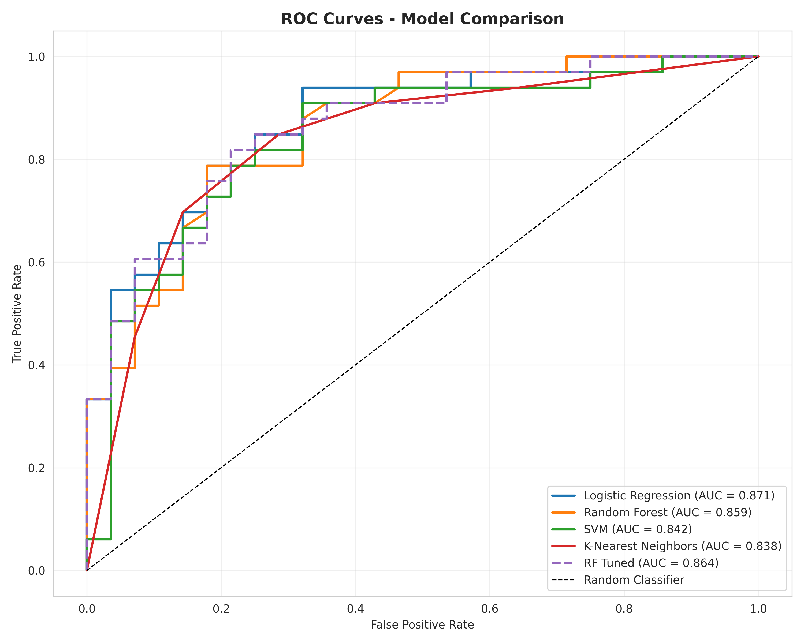
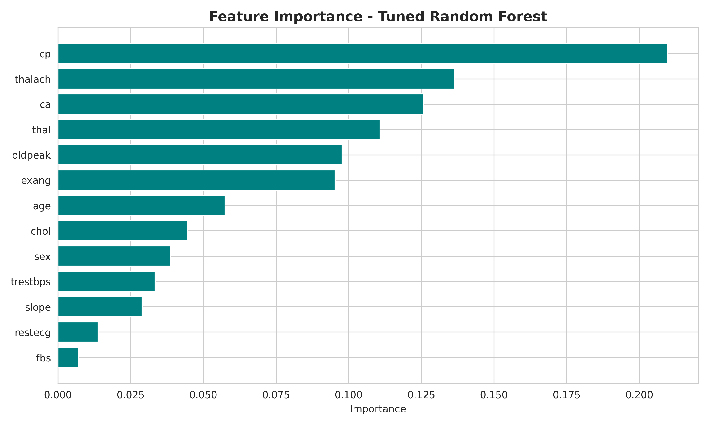

# Heart Disease Prediction

Predicts whether a patient has heart disease from 13 routine clinical measurements, comparing Logistic Regression, Random Forest, SVM and KNN. The models aren't the interesting part of this project, though. The data is.

## The catch: 70% of the dataset is duplicates

The popular 1,025-row version of the UCI heart dataset contains **only 302 unique patients**. Leave the duplicates in, and **202 of the 205 test rows also appear in the training set**, so a Random Forest scores a perfect **100% accuracy**. Is the model brilliant? No, it has simply seen the answer key. That's **data leakage**, and it's why so many notebooks online report near-perfect scores on this dataset.

In this notebook I remove the duplicates before splitting and demonstrate the leak explicitly, so you can see the inflated score next to the honest one.

## Results (302 unique patients, stratified 80/20 split)

| Model | Accuracy | Precision | Recall | F1 | ROC-AUC |
|---|---|---|---|---|---|
| **Logistic Regression** | **0.803** | **0.800** | **0.848** | **0.824** | **0.871** |
| K-Nearest Neighbors | 0.787 | 0.778 | 0.848 | 0.812 | 0.838 |
| Random Forest (tuned) | 0.787 | 0.794 | 0.818 | 0.806 | 0.864 |
| SVM | 0.770 | 0.771 | 0.818 | 0.794 | 0.842 |
| Random Forest | 0.754 | 0.765 | 0.788 | 0.776 | 0.859 |

- The **simplest model wins**. On a small dataset, Logistic Regression generalises best, and it's also the easiest one to explain to a clinician. In healthcare, I think that matters more than a fraction of a point.
- I prioritise **recall** on the disease class, because missing a sick patient is far more costly than a false alarm that leads to one extra check-up.
- The test set has only 61 patients, so single-split results are noisy. The tuned Random Forest's 5-fold CV accuracy (0.85) gives a steadier picture.

| ROC curves | Feature importance |
|---|---|
|  |  |

The strongest predictors are chest pain type, number of major vessels, thalassemia result, ST depression and max heart rate. That lines up with what cardiologists already look at, which is a good sign the model learned something real.

## Run it

```bash
pip install -r requirements.txt
jupyter notebook heart_disease_prediction.ipynb
```

*report.pdf* is the full write-up: abstract, methodology, results and discussion.

## Data

The data is the [UCI Heart Disease dataset](https://archive.ics.uci.edu/dataset/45/heart+disease) (Cleveland), in the 1,025-row Kaggle version stored in *data/heart.csv*.

## Tech stack

Python · pandas · scikit-learn · matplotlib · seaborn
