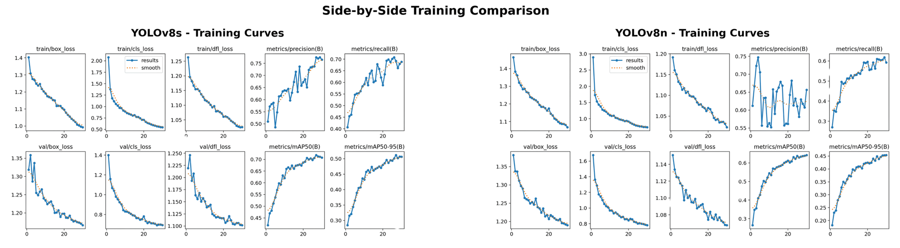
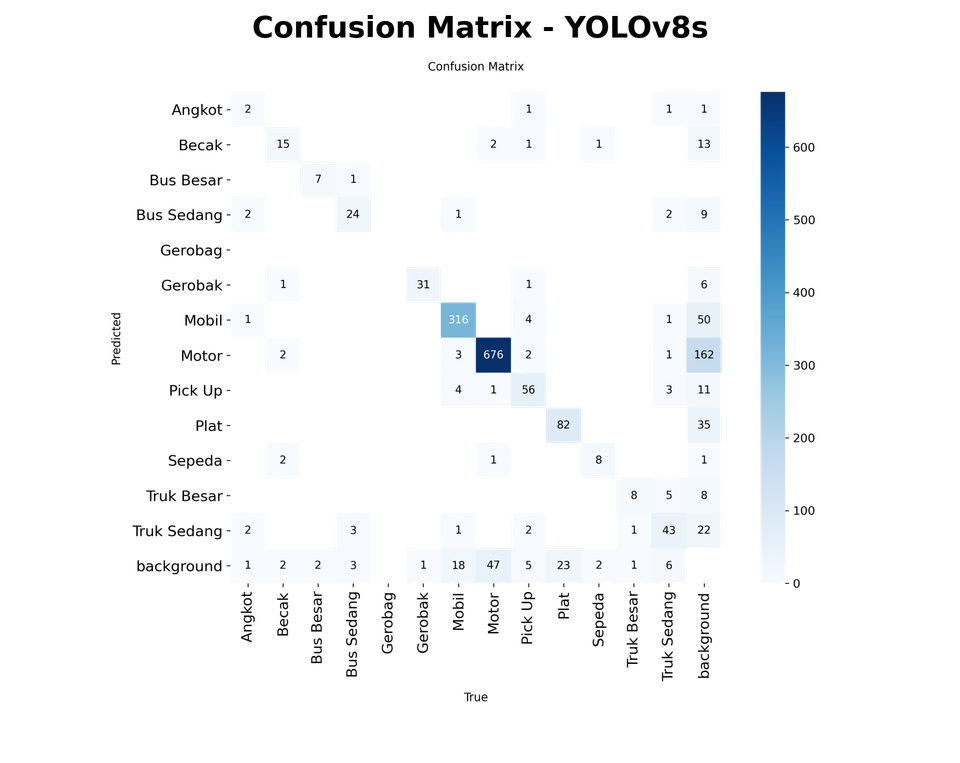

# Vehicle & License Plate Detection with YOLOv8

A detector for **13 classes of Indonesian road users**, including **license plates**, in a single image. Why not just use an off-the-shelf COCO model? Because it has never seen an *angkot* (city minibus), a *becak* (pedicab) or a street cart, and Indonesian roads are full of them. Possible uses include traffic analysis, parking and gate monitoring, and plate identification.

**▶ [Try the live demo](https://dextrafaren66-cmyk.github.io/data-science-portfolio/demo/)**. It runs the trained model right in your browser (exported to ONNX, no server), so you can drop in your own street photo and see what it finds.

## Results (test set, 212 images)

| Model | Params | mAP50 | mAP50-95 | Precision | Recall | Inference |
|---|---|---|---|---|---|---|
| **YOLOv8s** (final) | 11.1M | **0.814** | **0.574** | **0.793** | **0.765** | 10.5 ms/img |
| YOLOv8n | 3.0M | 0.761 | 0.533 | 0.748 | 0.678 | **5.1 ms/img** |

- YOLOv8s wins on every accuracy metric, and the biggest gap is in **recall** (+8.7 points). YOLOv8n is about twice as fast, which makes it the better fit for edge devices. For traffic monitoring, though, I'd still pick the s model: missing 9% more vehicles costs more than 5 ms ever will.
- Cars and motorbikes are detected best (mAP50 ≈ 0.95 and 0.93), which makes sense since they're also the most common classes.
- **License plates are the hardest class** (mAP50 0.73, mAP50-95 0.40). A box that's a few pixels off is a tiny miss on a car but a big miss on a plate.
- Training and validation losses fall together, so there's no sign of overfitting.





## Approach

1. **Data.** A Roboflow dataset in YOLO format with a 1,347 / 440 / 212 train, validation and test split.
2. **Preprocessing.** Resize to 640×640, plus mosaic, flip and HSV augmentation so the model sees more variety than the raw images give it.
3. **Transfer learning.** Fine-tune COCO-pretrained YOLOv8s for 30 epochs, batch 8, early stopping (patience 10), seed 42 in deterministic mode. It's like hiring someone who can already drive and only teaching them the local roads: the model already knows what wheels and edges look like, it just needs to learn angkot and becak.
4. **Comparison.** Train YOLOv8n with identical settings, so the accuracy vs speed trade-off is a fair one.
5. **Browser demo.** The final model is exported to ONNX so it can run in any browser (see below).

### Classes

| Label | Meaning | Label | Meaning |
|---|---|---|---|
| Mobil | car | Truk Besar / Sedang | large / medium truck |
| Motor | motorbike | Bus Besar / Sedang | large / medium bus |
| Pick Up | pickup truck | Angkot | city minibus |
| Plat | license plate | Becak | pedicab |
| Sepeda | bicycle | Gerobak / Gerobag | cart |

## Run it

```bash
# PyTorch first. For an NVIDIA GPU (CUDA 12.8); drop the --index-url for CPU only:
pip install torch torchvision --index-url https://download.pytorch.org/whl/cu128
pip install -r requirements.txt

# 1. Build the dataset from the Roboflow export (see data/README.md for the download)
python prepare_dataset.py "Deteksi Kendaraan.v5-dataset1.yolov8.zip"

# 2. Train + evaluate on the test set
python train.py                      # YOLOv8s (main model)
python train.py --model yolov8n.pt   # optional: lighter comparison model
```

**About the data subset.** The Roboflow export has 5,014 images, but training used about 40% of it (1,347 / 440 / 212) so it would fit on a 6 GB laptop GPU. The *prepare_dataset.py* script rebuilds that setup: the **test set is the exact 212 images** behind the reported results (listed in *test_subset.txt*), while train and validation are re-sampled with a fixed seed. So a retrained model will land close to the numbers above, but not exactly on them. Add `--full` to train on all 5,014 images instead.

The notebook *vehicle_detection.ipynb* has the full walkthrough: dataset checks, training, evaluation and the model comparison. The original run used an RTX 3060 laptop GPU (6 GB), and I'd strongly recommend a GPU for training. On a CPU you'll be waiting a long time.

## Browser demo

The live demo in *docs/demo* runs the same model without any server. I exported *best.pt* to ONNX and run it with ONNX Runtime Web; the page does the letterboxing and non-max suppression in JavaScript. On the four example photos it returns exactly the same boxes and scores as Ultralytics in Python. Why in the browser? A static page on GitHub Pages is free to host, never sleeps, and never sees the visitor's photos.

To rebuild the demo model after retraining:

```bash
yolo export model=runs/detect/vehicle_detection_yolov8s/weights/best.pt format=onnx imgsz=640 simplify=True
```

Then split the .onnx file into parts smaller than 20 MB, replace the files in *docs/demo/model*, and update *MODEL.bytes* in *docs/demo/demo.js*.

## Next steps

- A two-stage pipeline: detect the plate first, then run OCR to actually read the number.
- A higher input resolution (e.g. 960) or SAHI tiling, to improve recall on small objects.
- More data for the rare classes. Large buses, bicycles and large trucks have fewer than 12 test images each, so their scores are noisy.

## Team

This was a group project for a university deep learning course, and I was the one writing the code: the dataset checks and the training and evaluation of both models.

## Tech stack

Python · PyTorch · Ultralytics YOLOv8 · ONNX Runtime Web · Roboflow
