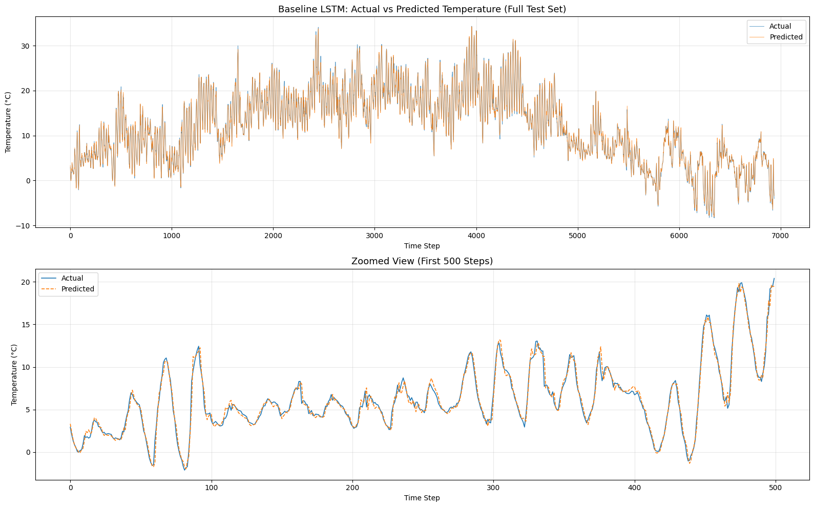
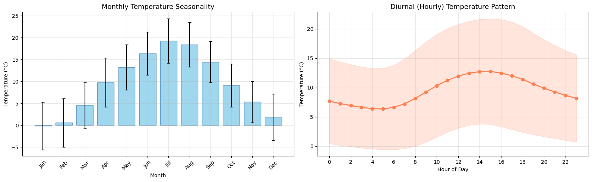

# Hourly Temperature Forecasting with LSTMs (PyTorch)

This model forecasts next-hour air temperature from the previous 72 hours of weather measurements. The more important question, though, is a simpler one: does a deep model actually beat the obvious baselines? I think a forecasting project that skips that question is only half done.

## Results (chronological test set, 6,938 hourly windows)

| Model | MAE (°C) | RMSE (°C) | R² |
|---|---|---|---|
| Seasonal naive (same hour yesterday) | 2.38 | 3.10 | 0.843 |
| Persistence (next hour = this hour) | 0.74 | 1.04 | 0.982 |
| **Stacked LSTM** (54k params) | **0.48** | **0.69** | **0.992** |
| Bidirectional LSTM (140k params) | 0.48 | 0.68 | 0.992 |

- Just repeating the last value already gives **R² = 0.98**. So if I only reported R², any model would look brilliant. Measured against **persistence** instead, the LSTM **cuts the error by about 35%** (MAE 0.74 → 0.48 °C), and that's the number that means something.
- The bidirectional LSTM gains less than 0.01 °C for 2.6× the parameters. Not worth it, so the simpler model stays.
- Errors are centred on zero (mean +0.04 °C), with no bias anywhere in the −10 to 35 °C range.



## Approach

1. **EDA.** 420k readings taken every 10 minutes, 2009–2016. I looked at yearly and daily seasonality, ran a correlation analysis to drop redundant derived features, and found −9999 sensor error values hiding in wind speed.
2. **Preprocessing.** Clip the sensor errors, subsample to hourly, keep 5 non-redundant features (pressure, temperature, humidity, wind speed, wind direction), split **chronologically** 70/20/10, and fit the scaler on the training set only. Why chronological? A random split would let the model peek at the future, which is exactly what a forecast can't do.
3. **Windowing.** 72-hour sliding windows, each predicting the temperature 1 hour ahead.
4. **Model.** A 2-layer LSTM (hidden size 64, dropout 0.2) feeding a dense head. Training uses Adam, gradient clipping, *ReduceLROnPlateau* and early stopping.
5. **Evaluation.** MAE, RMSE and R² in °C, always next to the persistence and seasonal naive baselines, plus error analysis and a BiLSTM ablation.



## Run it

```bash
pip install torch --index-url https://download.pytorch.org/whl/cu128   # NVIDIA GPU; plain `pip install torch` for CPU
pip install -r requirements.txt
jupyter notebook weather_forecasting_lstm.ipynb
```

Training both models took about 40 minutes on a 2-core CPU. A GPU is much faster.

## Next steps

- Multi-step forecasting (e.g. the next 24 hours). That's where persistence breaks down, so it's where a learned model has the most room to prove itself.
- Cyclical time features (sin and cos of hour of day and day of year).
- A gradient boosting baseline on lag features.

## Data

The data is included as *data/jena_climate_2009_2016.csv* (43 MB), and *download_data.py* re-downloads it if needed. It's the [Jena Climate 2009–2016](https://www.kaggle.com/datasets/stytch16/jena-climate-2009-2016) dataset from the Max Planck Institute for Biogeochemistry weather station in Jena, Germany.

## Tech stack

Python · PyTorch · pandas · scikit-learn · matplotlib · seaborn
